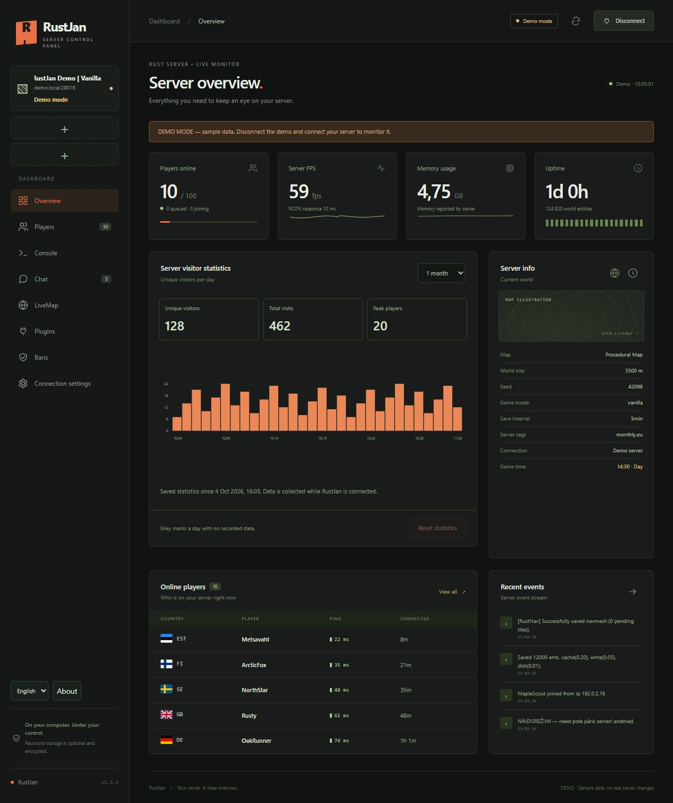
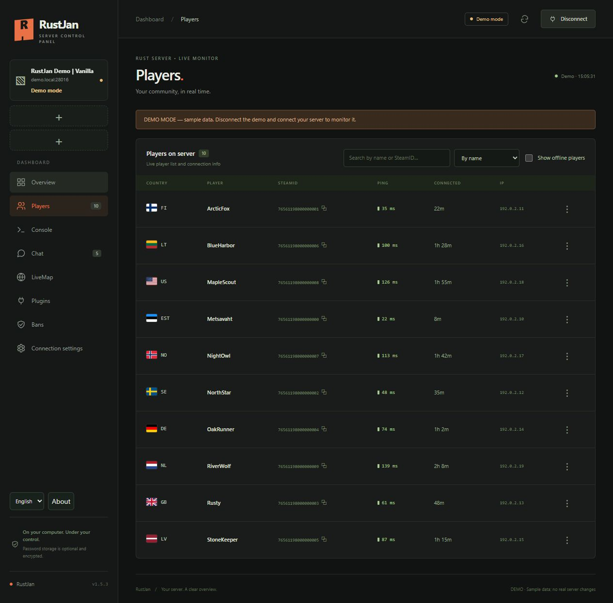
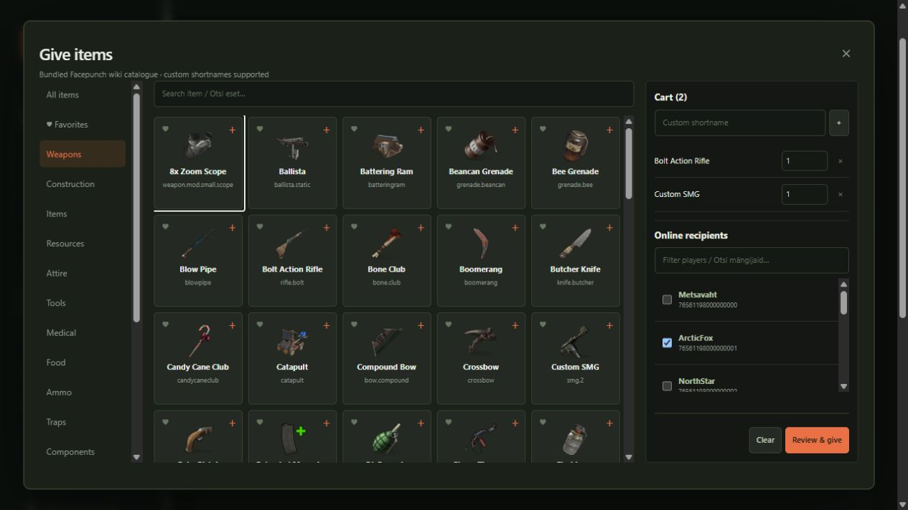
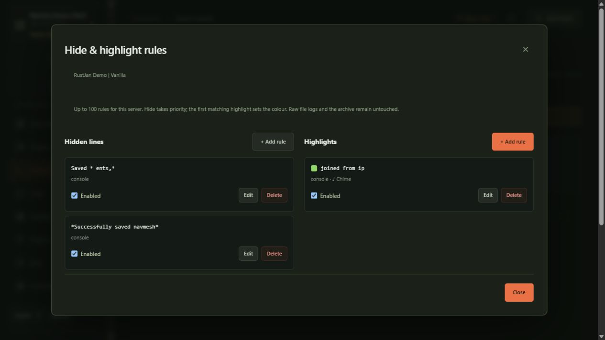

# RustJan

**Your Rust server, under control.** A local Windows desktop dashboard, vibe coded by **Jannu** for his own server administration needs.

[](https://github.com/jannu0180/RustJan/releases/latest)
[](https://github.com/jannu0180/RustJan/actions/workflows/test.yml)
[](LICENSE)

**[Download the Windows ZIP](https://github.com/jannu0180/RustJan/releases/latest)** · **[Eestikeelne juhend](README.et.md)** · **[Report a bug](https://github.com/jannu0180/RustJan/issues/new/choose)** · **[Suggest a feature](https://github.com/jannu0180/RustJan/issues/new/choose)**

## What it does

- Monitor up to **three Rust servers** through WebRCON, with background logging and a Windows system tray icon.
- View players, ping, connection time, approximate IP-country flags, offline visits and observed name history.
- Read console/chat streams; search saved logs by date without changing the originals.
- Create multiple hide/highlight rules, choose colours and play local one-shot notification sounds.
- Manage kicks, bans, mute and item delivery through explicit, confirmed actions.
- Browse items with offline icons, categories, a basket and recipient selection.
- Manage Oxide/uMod plugins and save a homepage URL for each plugin, per server.
- See live player positions, sleepers, tool cupboards and supported helicopter/airdrop events with the optional RustJanBridge plugin.
- Keep visitor statistics, maps, logs and history on your own PC. English and Estonian interface.

Screenshots below use a separate demo with fictional players and documentation-only network addresses.






## Install and run

1. Open **[Releases](https://github.com/jannu0180/RustJan/releases)** and download `RustJan-v1.5.3-win-x64.zip` under **Assets**. GitHub's automatic “Source code” ZIP is for developers, not the ready-to-run application.
2. Extract the **whole ZIP** into a writable folder, for example `Documents\RustJan`.
3. Run **`RustJan.exe`** inside the extracted folder. Keep its companion files and `assets` folder together.
4. Open **Connection settings**, enter your server address, **RCON port** and RCON password, then connect. The game/query/Rust+ ports are separate and do not replace the RCON port.

The release targets **Windows 11 x64 (Intel/AMD)**. Electron/Chromium/Node.js are included; no separate Node.js or browser installation is required. This initial release has not been validated on every Windows configuration. The EXE is not code-signed. SHA-256 checksums are provided with each release.

The ZIP contains the desktop app, not an installer. No setup wizard, automatic updater or desktop shortcut is installed. You may create a normal Windows shortcut yourself.

### System tray

- **X / Alt+F4 hides** RustJan to the tray; monitoring and enabled logging continue.
- Click the tray icon or choose **Open RustJan** to restore it.
- Choose **Exit RustJan** from the tray/application menu to save and stop it.
- Remembered servers can reconnect on launch. The RustJan menu can disable this.

## Configure the Rust server

WebRCON must be enabled **on the Rust server**, using its host panel/startup configuration:

```text
rcon.web 1
rcon.port 28016
rcon.password "YOUR_OWN_STRONG_PASSWORD"
```

The RCON port must be reachable from your PC. Use the server's RCON port, not its gameplay port. RustJan connects only to the server you select. Plain `ws://` is unencrypted; use a trusted network or a correctly configured secure `wss://` endpoint. Do not publish your RCON password in an issue or screenshot.

### Optional RustJanBridge: LiveMap and server items

1. Install a Rust-compatible **Oxide/uMod** build on your server.
2. Copy **`server-plugin/RustJanBridge.cs`** from the ZIP to the **server's** `oxide/plugins/` folder, not a folder on your client PC.
3. Check the server console for successful compilation. If necessary run `oxide.reload RustJanBridge`.
4. In RustJan, check the plugin status, open LiveMap and choose **Load map image** once for the current world/wipe.

Bridge version **1.4.0** provides player positions, sleepers, TC positions and the running server's item catalogue. It also tracks patrol helicopters, cargo planes, airdrops and supported helicopter loot/crash markers. It does not promise a flight's future destination or show loot contents. TC OwnerID identifies the cupboard's placer; it is not a complete list of building owners/authorized players. Moving positions do not regenerate the terrain image.

Sleepers and TCs are opt-in checkboxes and refresh only while LiveMap is requested, with per-layer limits. Missing/unloaded bridge support is explained in the UI. Monthly Rust/Oxide updates may require compatibility fixes; successful compilation on the actual server is the final compatibility check.

The optional **CountryGuard** is a separate server plugin. It is **not enabled by installing the desktop app**. See [its setup guide](server-plugin/COUNTRY-GUARD-README.txt): it defaults to blocking detected RU/BY IP countries, allows unidentified countries and creates no permanent SteamID bans. Its rules are configurable. IP geolocation is approximate and VPNs can bypass country rules.

## Local data and privacy

RustJan creates these folders next to `RustJan.exe`:

| Folder | Contents |
| --- | --- |
| `conf/` | Local profiles, preferences, optional DPAPI-encrypted passwords and imported sounds |
| `logs/<server>/` | Enabled chat/console logs, player/name history, statistics, maps, plugin URLs and display rules |
| `assets/item-icons/` | Included local item images; no runtime icon downloads |

Saved passwords are tied to your Windows user account. On another PC/account, re-enter them. No credentials, private server profiles, collected logs, player records or research material are included in the public release.

There is **no application telemetry or analytics** and no data sent to Jannu. RCON credentials/commands go to the Rust server you choose. GitHub counts release downloads independently of the app. Opening a plugin homepage or GitHub link opens that external service in your browser. Logs can contain player IPs and chat: keep your `conf` and `logs` folders private.

**Hide rules affect only the live display.** Files and the archive stay intact. `*` matches any text; matching is case-insensitive unless selected otherwise. Up to 100 rules can be saved per server. Hidden lines take priority over highlights. A notification sound is triggered once for a new matching entry, not by opening a view or reloading history. Import your own WAV/MP3/OGG files (up to 5 MB).

### Updating from another ZIP

Exit RustJan completely. Back up `conf/` and `logs/`. Extract the new release to a new writable folder and copy your own `conf/` and `logs/` into it, then launch its `RustJan.exe`. Keep the new release's companion files and assets. Do not run two versions against the same data folder. Update the server plugin only when the release notes require it.

## Downloads, bugs and contributions

- The badge counts downloads of the **Windows ZIP**, not unique people, installs or active users. Repeated/automated downloads can be counted.
- Release asset counts are available through [GitHub's releases API](https://api.github.com/repos/jannu0180/RustJan/releases). Run `node scripts/download-stats.mjs` for a ZIP-only version table, or use the **Download statistics** workflow under Actions.
- The repository owner can view visitors/clones under **Insights → Traffic**; GitHub exposes a rolling 14-day window.
- Use **Issues** for bugs and suggestions. Remove passwords, IPs, SteamIDs and private chat from attachments.
- Public users have read access. They cannot push edits to this repository. They may fork the open source code and submit a pull request; **Jannu decides whether to merge it**.

## Development

Node.js **24** is recommended for development. Runtime server code has no npm dependencies.

```powershell
node --test tests/*.test.mjs
node server.mjs --open
```

The web development view runs on loopback (`127.0.0.1:8787` by default). `RUSTJAN_PORT` changes that port. Tests use isolated temporary/test data. Do not point development work at your production data folder.

Build the Windows desktop ZIP from source:

```powershell
node scripts/fetch-icons.mjs
npm.cmd ci --prefix desktop
node desktop/build.mjs out/RustJan
node scripts/prepare-bundle.mjs out/RustJan
Compress-Archive -Path out/RustJan -DestinationPath out/RustJan-v1.5.3-win-x64.zip
```

Item artwork is fetched once from Facepunch's asset host and checked against the manifest. It is omitted from Git history to keep source clones smaller, but included locally in the release ZIP. See [third-party notices](THIRD_PARTY_NOTICES.md). The `Build release` workflow builds a portable ZIP for version tags; publishing remains under the owner's GitHub permissions.

## License and disclaimer

RustJan's original source is **MIT licensed**. Third-party assets and dependencies retain their own rights/licenses; MIT does not relicense Facepunch artwork. This is an independent project and is **not affiliated with or endorsed by Facepunch Studios or Rust**.

**Provided as is, without warranty. Use at your own risk. To the extent permitted by applicable law, Jannu accepts no responsibility for data loss, server downtime, bans, configuration mistakes or any other loss or damage arising from use. You are responsible for your server, backups and the commands you confirm.** See [LICENSE](LICENSE).
